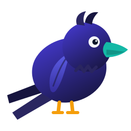
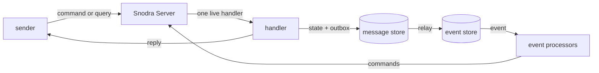

<div align="center">



# Snodra

**One messaging stack for services that speak events and gRPC.**

Commands, queries, events and sagas — routed by a stateless server, carried by Kafka or RabbitMQ
Streams, and stored in the databases you already run. No commercial messaging platform and no broker
in the request path.

[](https://snodra.damoreira.com/docs/)
[](https://github.com/snodra/snodra-server/releases)
[](https://central.sonatype.com/artifact/com.damoreira.snodra/snodra-messaging)
[](https://crates.io/crates/snodra-messaging-rs)
[](https://pkg.go.dev/github.com/snodra/snodra-messaging-go)
[](https://pypi.org/project/snodra-messaging/)
[](https://github.com/snodra/snodra-server/blob/main/LICENSE)

[Documentation](https://snodra.damoreira.com/docs/) ·
[Getting started](https://snodra.damoreira.com/docs/getting-started/) ·
[Core concepts](https://snodra.damoreira.com/docs/concepts/) ·
[Conformance](https://github.com/snodra/snodra-conformance)

</div>

---

## What is Snodra?

Snodra is a CQRS-style messaging stack for service fleets. A service sends a **command** or a
**query** and Snodra Server forwards it to a live handler of the type it targets; a service publishes
an **event** through its transactional outbox and every interested processor receives it. Services
can be written in different languages and still talk to each other: the wire protocol is the contract,
not the library.



The server routes and holds nothing; events never pass through it. State and the outbox live in your
message store (MongoDB or SQL), events live in your event store (Kafka or RabbitMQ Streams), and the
libraries give every service the same delivery, retry and saga semantics.

## Why Snodra?

- **The broker is not in the request path.** Commands and queries are matched to a live handler and
  answered directly. Deadlines, retries, streaming queries and flow control are enforced by the router,
  once, instead of by every client.
- **Events without dual writes.** Every publish goes through the outbox of the message store in the
  same transaction as the state change. A relay publishes it; processors are idempotent by
  construction with processed-event markers in the same store.
- **Sagas built in.** Long-running processes with associations, deadlines and a relay that retries
  commands — no separate workflow engine to operate.
- **Your infrastructure, your choice.** Kafka or RabbitMQ Streams for events; MongoDB, PostgreSQL or
  MySQL for the outbox, markers, dead letters and saga state. One event store and one message store per
  service, selected by an add-on.
- **One protocol, many languages.** The Kotlin, Rust, Go and Python clients are interchangeable in front
  of the server and on the event store. The [conformance suite](https://github.com/snodra/snodra-conformance)
  proves it, check by check, against a real server and fake hubs.
- **Production pieces included.** Static token, OAuth2/OIDC JWT and mTLS authentication with per-service
  ACLs, multi-server routing without server-to-server traffic, OTLP metrics, health probes and a
  dashboard served from the same binary.

## The suite

| Project | What it is | Stack | Get it |
|---|---|---|---|
| **[Snodra Server](https://github.com/snodra/snodra-server)** | The stateless gRPC router, dashboard and control plane | Rust, tonic | `docker run -p 7000:7000 -p 7001:7001 snodra/snodra-server:0.6.0` |
| **[snodra-messaging](https://github.com/snodra/snodra-messaging)** | Spring Boot starter: buses, handlers, outbox, sagas, testing kits | Kotlin, Spring Boot 4 | [`com.damoreira.snodra:snodra-messaging`](https://central.sonatype.com/artifact/com.damoreira.snodra/snodra-messaging) |
| **[snodra-messaging-rs](https://github.com/snodra/snodra-messaging-rs)** | One builder for the hub client, event store, outbox and handlers | Rust | [`snodra-messaging-rs`](https://crates.io/crates/snodra-messaging-rs) |
| **[snodra-messaging-python](https://github.com/snodra/snodra-messaging-python)** | asyncio client for the same protocol, at feature level 2 | Python | [`0.6.0`](https://pypi.org/project/snodra-messaging/0.6.0/) |
| **[snodra-messaging-go](https://github.com/snodra/snodra-messaging-go)** | Go client for the same protocol, at feature level 2 | Go | [`v0.5.2`](https://github.com/snodra/snodra-messaging-go/releases/tag/v0.5.2) |
| **[snodra-event-browser](https://github.com/snodra/snodra-event-browser)** | Read-only event browser add-on for the dashboard | Rust | `docker run snodra/snodra-event-browser:0.3.3` |
| **[snodra-conformance](https://github.com/snodra/snodra-conformance)** | The protocol conformance runner and reference service | Rust | `cargo run -p snodra-conformance` |
| **[snodra-site](https://github.com/snodra/snodra-site)** | The documentation portal behind `snodra.damoreira.com` | Astro Starlight | [snodra.damoreira.com](https://snodra.damoreira.com/docs/) |

## Quick start

Run the server. It keeps no state, so this is safe to start on any machine:

```sh
docker run --rm -p 7000:7000 -p 7001:7001 snodra/snodra-server:0.6.0
```

gRPC is on `7000` and the dashboard on <http://localhost:7001/ui/>. With no configuration the server
accepts anonymous clients; production settings, TLS and ACLs are in the
[server reference](https://snodra.damoreira.com/docs/server/).

Add the client that matches your service.

**Kotlin / Spring Boot**

```kotlin
dependencies {
    implementation("com.damoreira.snodra:snodra-messaging:0.6.1")
    implementation("com.damoreira.snodra:snodra-messaging-kafka:0.6.1")   // or -rabbitmq
    implementation("com.damoreira.snodra:snodra-messaging-mongo:0.6.1")   // or -jdbc
    testImplementation("com.damoreira.snodra:snodra-messaging-test:0.6.1")
}
```

**Rust**

```sh
cargo add snodra-messaging-rs@0.8
cargo add snodra-messaging-kafka@0.8        # or snodra-messaging-rabbitmq
cargo add snodra-messaging-mongo@0.8        # or snodra-messaging-sqlx with a database feature
```

**Go**

```sh
go get github.com/snodra/snodra-messaging-go@v0.5.2
go get github.com/snodra/snodra-messaging-go/kafka@v0.5.2      # or /rabbitmq
go get github.com/snodra/snodra-messaging-go/mongo@v0.5.2      # or /sql
```

**Python**

```sh
pip install snodra-messaging==0.6.0
pip install snodra-messaging-kafka==0.6.0      # or snodra-messaging-rabbitmq
pip install snodra-messaging-mongo==0.6.0      # or snodra-messaging-sql
```

Then take the shortest path from a running server to a registered handler:
[Your first service](https://snodra.damoreira.com/docs/getting-started/first-service/). The
[installation guide](https://snodra.damoreira.com/docs/getting-started/installation/) has every artifact,
crate and database feature.

## One protocol, many languages

A Snodra service registers the command and query types it handles and opens one long-lived stream.
Any language can implement that protocol — the Kotlin, Rust, Go and Python libraries already do, and
the [conformance runner](https://github.com/snodra/snodra-conformance) checks a client against a real
server and fake hubs, with **PASS**, **FAIL**, **SKIPPED** and **NOT IMPLEMENTED** per check id. A
client that passes the feature levels it claims — level 1 through the runner, level 2 through the
event-store and message-store kits — is a first-class member of the suite, whichever language it is
written in.

## Documentation

| Section | What you will find |
|---|---|
| [Getting started](https://snodra.damoreira.com/docs/getting-started/) | Install the server and a client, then send a first command |
| [Core concepts](https://snodra.damoreira.com/docs/concepts/) | CQRS, commands, queries, events, sagas, processors and consistency |
| [Server](https://snodra.damoreira.com/docs/server/) | Routing, authentication, settings, dashboard, topology, processor control, protocol |
| [Kotlin library](https://snodra.damoreira.com/docs/messaging/kotlin/) | Quick start, configuration, API, testing and modules |
| [Rust library](https://snodra.damoreira.com/docs/messaging/rust/) | Quick start, configuration, API, testing and add-ons |
| [Go library](https://snodra.damoreira.com/docs/messaging/go/) | Quick start, configuration, API, testing and add-ons at feature level 2 |
| [Python library](https://snodra.damoreira.com/docs/messaging/python/) | Quick start, configuration, API, testing and add-ons at feature level 2 |
| [Add-ons](https://snodra.damoreira.com/docs/add-ons/) | Kafka, RabbitMQ Streams, MongoDB and SQL stores |
| [Operations](https://snodra.damoreira.com/docs/operations/) | Upgrades, deployment and observability |
| [Examples](https://snodra.damoreira.com/docs/examples/) | A working multi-service system with the sandbox |
| [Integrations](https://snodra.damoreira.com/docs/integrations/) | Partner systems and external sources |

## Contributing

Issues and pull requests are welcome in every repository.

- **Documentation** lives in [snodra-site](https://github.com/snodra/snodra-site); read its
  [contribution guide](https://github.com/snodra/snodra-site/blob/main/CONTRIBUTING.md) before opening
  a pull request.
- **Code** follows the repository it belongs to: branch from `main`, use conventional commits, and let
  the CI (format, clippy, tests, proto sync) pass before review.
- **Licence.** Everything here is [Apache-2.0](https://github.com/snodra/snodra-server/blob/main/LICENSE);
  by contributing you agree that your contribution is licensed under the same terms.

<p align="center">
  <sub>Snodra — commands, queries, events and sagas, without the platform in the middle.</sub>
</p>
